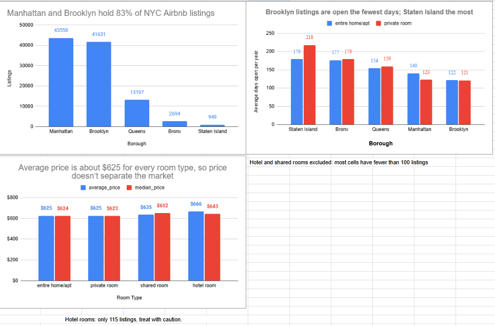

# NYC Airbnb: Data Cleaning and Market Analysis

I took the messy NYC Airbnb Open Data file (102,599 rows, 26 columns), cleaned it with a documented, repeatable Python script, proved the result with automated checks, and then used the clean data to answer a business question in Google Sheets.

**Google Sheet (cleaning log, before/after, pivot tables, charts):** [view it here](https://docs.google.com/spreadsheets/d/1JKiB5R72boHgGKv8_oDtw0rNqUOlTr4NmpB9BJXx3X8/edit?usp=sharing)



## Business question
> The host-growth team at Airbnb wants to recruit hosts and help existing hosts earn more. Which NYC boroughs and room types have the highest prices and the most availability, and where might there be room for new hosts?

## Results at a glance
| | Before | After |
|---|---|---|
| Rows | 102,599 | 102,058 |
| Columns | 26 | 22 |
| Logged fixes | | 25 |
| Automated quality checks passed | | 13 of 13 |

## What was wrong, and what I did
Every fix is written to `output/cleaning_log.csv` (what was wrong, which column, how many rows, what I did, how).

| Problem | Rows | Fix |
|---|---|---|
| Exact duplicate listings | 541 | Removed, kept the first copy |
| `price` stored as text (`$1,020 `) | 101,811 | Stripped symbols, converted to numbers |
| `service_fee` stored as text | 101,785 | Same |
| `last_review` stored as text | 86,226 | Converted to real dates |
| Availability outside 0-365 days | 3,185 | Set to blank (not guessed) |
| Minimum nights below 1 or above 365 | 48 | Set to blank |
| Review dates after the file was published (Aug 2022), e.g. 2058 | 5 | Set to blank |
| Misspelled boroughs (`brookln`, `manhatan`) | 2 | Corrected |
| Extra spaces in listing names | 3,493 | Trimmed |
| `reviews_per_month` blank when a listing has zero reviews | 15,673 | Filled with 0 |
| Useless columns (`license`, `country`, `country_code`, `house_rules`) | 4 columns | Dropped |

**Rules I followed:** impossible values become blank, not a guess. Things that look odd but can't be fixed from the data (for example, 40 listings with reviews but no review date) are flagged in the log and left alone.

## Findings
- **Supply is concentrated.** Manhattan (43,558) and Brooklyn (41,631) hold 83% of listings. Staten Island has 949.
- **Price does not separate the market in this data.** Average price is $623 to $630 in every borough, and about $625 for both entire homes and private rooms.
- **Availability does.** Brooklyn listings are open about 121 days a year (entire homes and private rooms). Staten Island private rooms are open about 218 days.
- **Suggestion:** Brooklyn and Manhattan look busiest but are already crowded. Queens and the Bronx have more open days with fewer competing listings, so they are worth testing first. This is a place to start a test, not a conclusion.

## Limitations
- **Price looks synthetic.** It is spread almost evenly from $50 to $1,200 and the service fee is exactly 20% of price in about 98% of rows, so real-world patterns (entire homes costing more) do not appear. Price findings are illustrative.
- **Availability is not demand.** There are no booking records, so open days only suggest demand.
- **29 listings (0.03%) have no borough** and are excluded from borough charts. 3,633 listings have no availability value.
- **Cells with fewer than 100 listings** (for example hotel rooms: 115 in total) are not used for conclusions.
- The data reflects August 2022.

## Run it yourself
```bash
pip install -r requirements.txt
python clean_airbnb.py --input data/Airbnb_Open_Data.csv
```
The raw file is included in `data/` so you can reproduce every number. The script writes to `output/`:

| File | Contents |
|---|---|
| `airbnb_clean.csv` | The cleaned table |
| `cleaning_log.csv` | One row per fix |
| `missing_values_report.csv` | Missing cells per column, before and after |
| `quality_checks.csv` | 13 pass/fail checks |

`send_to_sheets.py` uploads the log, report and checks to a Google Sheet (needs a service-account key saved as `credentials.json`, which is git-ignored).

## Project structure
```
airbnb-nyc-data-cleaning/
├── clean_airbnb.py
├── send_to_sheets.py
├── requirements.txt
├── data/            # raw file, untouched (Airbnb_Open_Data.csv)
├── output/          # cleaned data, log, report, checks
└── images/          # chart screenshots
```

## Data source
Airbnb Open Data (NYC), from Kaggle. The raw file is stored unchanged in `data/` for reproducibility. Check the dataset's licence on Kaggle before reusing it.

## Tools
Python (pandas, numpy), Google Sheets (pivot tables, charts)